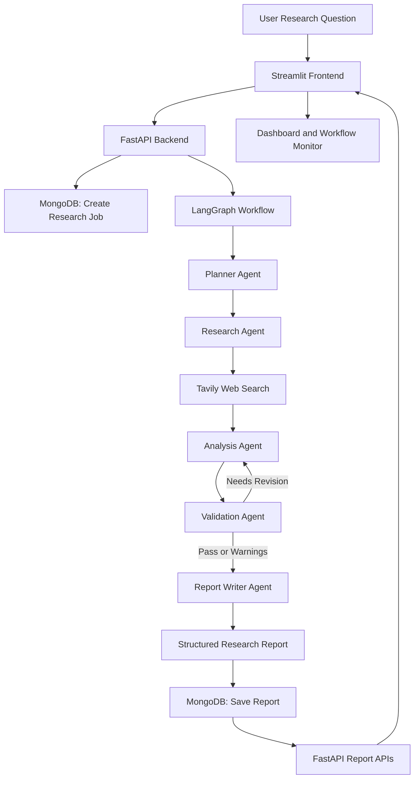

# AI Market Research & Strategy Engine

An AI-powered multi-agent research application that transforms business research questions into structured market intelligence, evidence-backed insights, and strategic recommendations.

[](https://www.python.org/)
[](https://www.langchain.com/langgraph)
[](https://fastapi.tiangolo.com/)
[](https://streamlit.io/)

---

## 🚀 Live Demo

| Resource | Link |
|---|---|
| Live Application | https://ai-market-research-engine-url.streamlit.app/ |
| GitHub Repository | https://github.com/Prashant945/ai-market-research-engine |
| Backend API | https://ai-market-research-engine-production.up.railway.app |
| API Documentation (Swagger) | https://ai-market-research-engine-production.up.railway.app/docs |
| API Health Check | https://ai-market-research-engine-production.up.railway.app/health |
| Demo Video | https://drive.google.com/file/d/1ptQysKh7mZf9hKBjXtGiaHyzvoTJYgPx/view?usp=sharing |


---

## 📌 Project Overview

Market research often requires collecting information from multiple sources, identifying industry trends, evaluating competitors, assessing risks, and translating findings into actionable business strategies.

This process can be time-consuming and involves repetitive research and analysis.

The **AI Market Research & Strategy Engine** automates much of this workflow using a multi-agent architecture powered by Large Language Models (LLMs).

A user submits a business research question. Multiple specialized AI agents collaborate to:

- Break down the research objective into smaller tasks.
- Search the web for relevant information.
- Extract and summarize market intelligence.
- Identify business opportunities, trends, competitors, and risks.
- Validate analytical outputs and provide revision feedback.
- Generate a structured market research report with source references.

### Example Research Question

"Analyze the Indian electric vehicle charging infrastructure market and identify business opportunities for launching an EV charging company."

### Expected Output

- Executive summary
- Research objective and methodology
- Market trends and findings
- Competitor insights
- Business opportunities
- Strategic risks
- Strategic recommendations
- Evidence gaps and validation summary
- References to research sources

---

## 🏗️ System Architecture

The application uses five specialized AI agents orchestrated through LangGraph.

### Architecture Diagram



### Technology Stack

| Component | Technology | Purpose |
|---|---|---|
| Programming Language | Python | Core development |
| LLM | Google Gemini | Reasoning, analysis, and report generation |
| Agent Orchestration | LangGraph | Workflow management and conditional routing |
| LLM Framework | LangChain | Model integration and prompt management |
| Structured Outputs | Pydantic | Schema validation of model responses |
| Web Search | Tavily | Collect external research information |
| Backend | FastAPI | REST API development |
| Database | MongoDB Atlas | Store research jobs, statuses, and reports |
| Frontend | Streamlit | Interactive dashboard and application UI |
| Deployment | Railway | Backend hosting |
| Frontend Hosting | Streamlit Community Cloud | Frontend hosting |

---

## 🤖 Multi-Agent Workflow

### 1. Planner Agent

**Responsibility:** Convert the user's business research question into a structured research plan.

It identifies:
- Research objective
- Industry and geography
- Timeframe
- Research tasks
- Research questions
- Search keywords
- Task priorities

Uses Gemini with Pydantic structured output to produce a `ResearchPlan`.

### 2. Research Agent

**Responsibility:** Collect relevant market information from external sources.

Process:
1. Receives the research plan.
2. Extracts search keywords from individual tasks.
3. Uses Tavily to retrieve relevant web results.
4. Removes duplicate URLs.
5. Assigns unique source IDs.
6. Uses Gemini to summarize collected information.
7. Produces structured research findings.

Output: `ResearchOutput`

### 3. Analysis Agent

**Responsibility:** Convert collected research into business intelligence.

It identifies:
- Market trends
- Business opportunities
- Target customer segments
- Competitor insights
- Strategic risks
- Data conflicts
- Strategic recommendations
- Evidence gaps

Output: `AnalysisOutput`

### 4. Validation Agent

**Responsibility:** Evaluate the analytical output before report generation.

It checks for:
- Unsupported claims
- Logical gaps
- Conflicting information
- Missing evidence
- Invalid source references

It produces validation feedback and an overall status:

- `pass`
- `pass_with_warnings`
- `needs_revision`

If revision is required, LangGraph routes the workflow back to the Analysis Agent.

### 5. Report Writer Agent

**Responsibility:** Generate the final structured market research report.

The report includes:
- Title and executive summary
- Research objective
- Scope and methodology
- Research findings
- Strategic recommendations
- Validation summary
- Evidence gaps
- Conclusion

---

## 🔄 LangGraph Workflow Orchestration

LangGraph manages the execution of the five agents using a shared research state.

The workflow follows this sequence:

1. Planner
2. Researcher
3. Analyst
4. Validator
5. Report Writer

A conditional edge connects the Validator to the Analyst when revisions are required.

The workflow limits the number of analysis attempts to avoid an indefinite revision loop.

---

## 🖥️ Application Features

### Dashboard
- Total research projects
- Completed research projects
- Active research projects
- Recent research activity

### New Research
- Submit a business research question.
- Start the AI research workflow.
- Receive a unique research ID.

### Workflow Monitor
- Track individual agent execution.
- View agent statuses.
- Monitor overall research progress.
- Automatically refresh workflow status.
- View the completed report.

### Research History
- Browse previously submitted research questions.
- View research status and timestamps.
- Retrieve completed research reports.

### Report Generation
- Structured research findings.
- Source references and clickable links.
- Strategic recommendations.
- Downloadable Markdown reports.

---

## 📁 Project Structure

```text
AI_Market_Research_Engine/
│
├── ai_engine/
│   ├── agents/
│   │   ├── planner.py
│   │   ├── researcher.py
│   │   ├── analyst.py
│   │   ├── validator.py
│   │   └── report_writer.py
│   │
│   ├── prompts/
│   │   ├── planner_prompt.py
│   │   ├── analysis_prompt.py
│   │   ├── validation_prompt.py
│   │   └── report_writer_prompt.py
│   │
│   ├── tools/
│   │   └── tavily_search.py
│   │
│   └── workflow/
│       ├── state.py
│       ├── node.py
│       └── graph.py
│
├── backend/
│   ├── __init__.py
│   ├── main.py
│   └── database.py
│
├── frontend/
│   └── app.py
│
├── main.py
├── requirements.txt
├── .env
└── README.md
```

---

## ⚙️ Local Installation and Setup

Follow these instructions to run the application locally.

### Prerequisites

- Python 3.x
- Git
- MongoDB Atlas account or MongoDB connection
- Google Gemini API key
- Tavily API key

### Step 1: Clone the Repository

```bash
git clone https://github.com/Prashant945/ai-market-research-engine.git

cd ai-market-research-engine
```

### Step 2: Create a Virtual Environment

Windows:

```bash
python -m venv venv
venv\Scripts\activate
```

macOS / Linux:

```bash
python -m venv venv
source venv/bin/activate
```

### Step 3: Install Dependencies

```bash
python -m pip install --upgrade pip

pip install -r requirements.txt
```

### Step 4: Configure Environment Variables

Create a `.env` file in the project root directory.

Add:

```env
GOOGLE_API_KEY=your_google_gemini_api_key

TAVILY_API_KEY=your_tavily_api_key

MONGODB_URI=your_mongodb_atlas_connection_string

GEMINI_MODEL=gemini-3.5-flash-lite
```

Replace the placeholder values with your actual credentials.

**Important:** Never commit your `.env` file or expose API keys in GitHub.

### Step 5: Run the FastAPI Backend

Open the first terminal from the project root:

```bash
python -m uvicorn backend.main:app --reload
```

Backend will be available at:

```text
http://127.0.0.1:8000
```

FastAPI Swagger documentation:

```text
http://127.0.0.1:8000/docs
```

### Step 6: Run the Streamlit Frontend

Open a second terminal:

```bash
python -m streamlit run frontend/app.py
```

Streamlit will provide a local URL, usually:

```text
http://localhost:8501
```

The application should now be accessible locally.

---

## 🔌 API Endpoints

The FastAPI backend exposes the following REST endpoints.

| Method | Endpoint | Description |
|---|---|---|
| GET | `/` | Backend welcome message |
| GET | `/health` | Health check |
| POST | `/research` | Submit a new research question |
| GET | `/research` | Retrieve all research jobs |
| GET | `/research/{research_id}` | Retrieve a research record |
| GET | `/research/{research_id}/status` | Check workflow and agent status |
| GET | `/reports/{research_id}` | Retrieve the generated report |
| GET | `/reports/{research_id}/export` | Download report as Markdown |

### Example: Submit a Research Request

**Request**

```http
POST /research
Content-Type: application/json
```

```json
{
  "question": "Analyze the Indian EV charging infrastructure market and identify business opportunities."
}
```

**Response**

```json
{
  "status": "pending",
  "research_id": "generated-research-id",
  "research_question": "Analyze the Indian EV charging infrastructure market and identify business opportunities.",
  "message": "Research workflow started successfully"
}
```

The research ID can be used to monitor workflow execution and retrieve the final report.

---

## 🗄️ Database Design

MongoDB Atlas is used for persistent storage.

The application stores data in the `research_reports` collection.

A research document contains fields such as:

- `research_id`
- `question`
- `status`
- `agent_status`
- `created_at`
- `updated_at`
- `completed_at`
- `report`
- `error`

The report includes structured findings and the original research source information.

---

## ☁️ Deployment Architecture

The application is deployed using three services.

| Service | Platform | Responsibility |
|---|---|---|
| Frontend | Streamlit Community Cloud | Hosts the user interface |
| Backend | Railway | Runs FastAPI and LangGraph |
| Database | MongoDB Atlas | Stores research data and reports |

### Deployment Configuration

**Railway Environment Variables**

```env
GOOGLE_API_KEY=your_google_gemini_api_key
TAVILY_API_KEY=your_tavily_api_key
MONGODB_URI=your_mongodb_atlas_connection_string
GEMINI_MODEL=gemini-3.5-flash-lite
```

**Railway Start Command**

```bash
uvicorn backend.main:app --host 0.0.0.0 --port $PORT
```

**Streamlit Community Cloud Secret**

```toml
API_URL = "https://your-railway-domain"
```

The frontend uses this URL to communicate with the deployed FastAPI backend.

---

## 🔮 Future Improvements

- Durable background job processing using Celery or Redis.
- More robust evidence verification and source validation.
- Parallel execution of independent research tasks.
- User authentication and research access management.
- PDF report export.
- Advanced research analytics and visualizations.
- Improved error handling, observability, and performance monitoring.
- Configurable research models and provider integrations.

---

## ⚠️ Current Limitations

- Research quality depends on the availability and relevance of external web sources.
- LLM-generated analysis may contain errors and should be reviewed before business decisions are made.
- The validation agent evaluates analytical consistency and evidence references but does not independently prove every claim against its original webpage.
- The current backend uses FastAPI BackgroundTasks. It is suitable for an MVP but is not a durable distributed job queue; a process restart can interrupt an active job.
- Research execution and API usage depend on external Gemini and Tavily services.

---

## 👨‍💻 Author

**Prashant Agarwal**

GitHub: https://github.com/Prashant945

---

## ⭐ Acknowledgements

- [LangChain](https://www.langchain.com/)
- [LangGraph](https://www.langchain.com/langgraph)
- [Google Gemini](https://ai.google.dev/)
- [Tavily](https://tavily.com/)
- [FastAPI](https://fastapi.tiangolo.com/)
- [Streamlit](https://streamlit.io/)
- [MongoDB Atlas](https://www.mongodb.com/atlas)

If you find this project useful, consider giving the repository a star.
